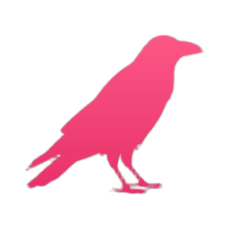
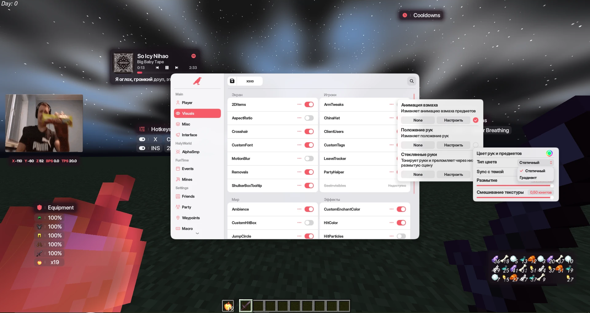
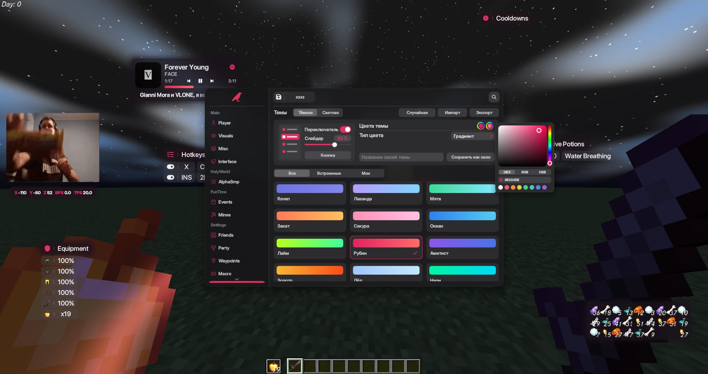
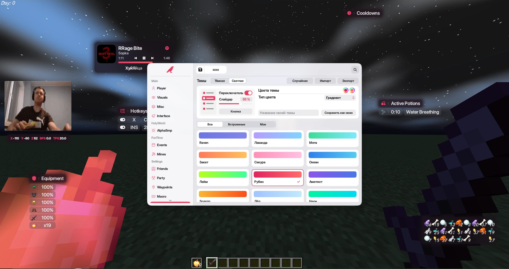
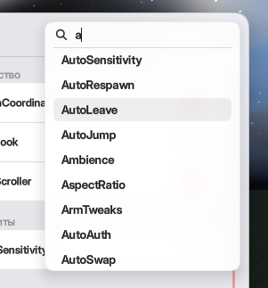
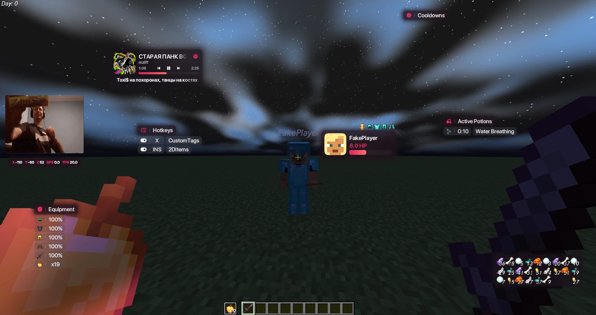
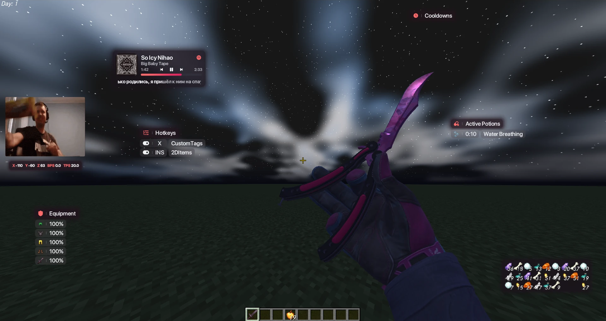
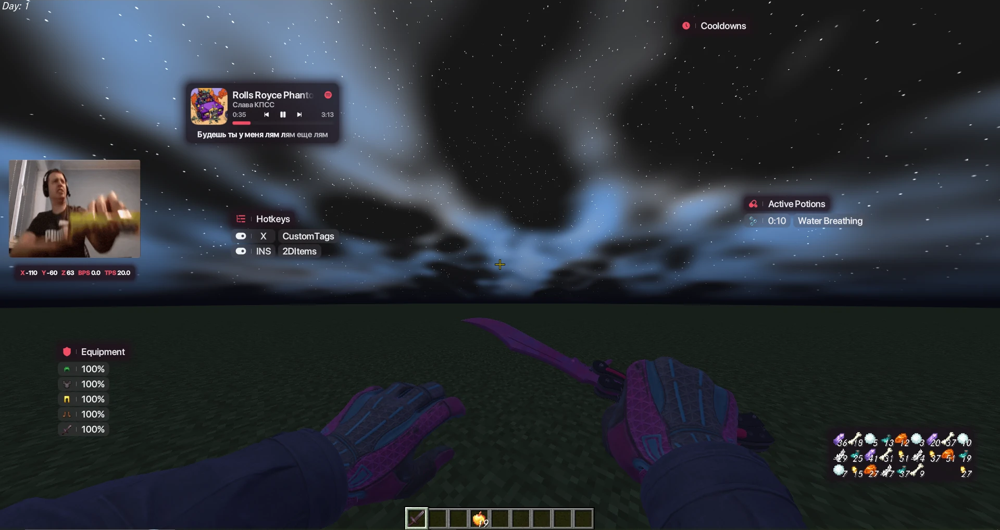
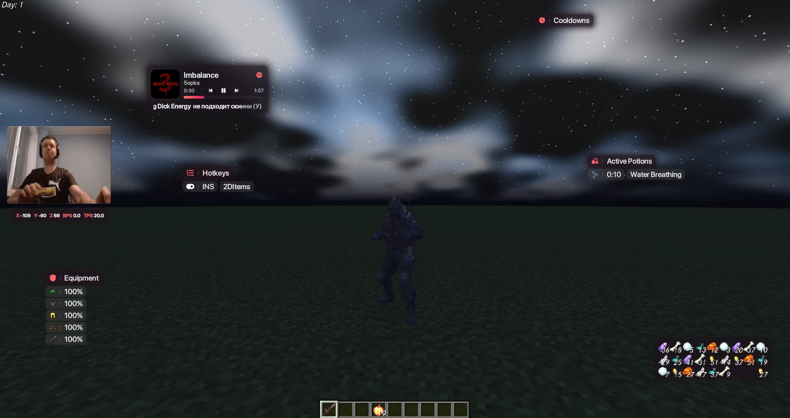
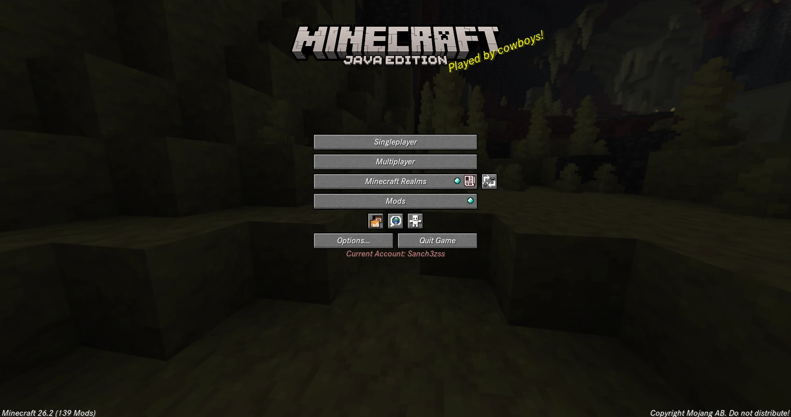

<div align="center">



# Raven Visuals

**Визуальный клиент для Minecraft 26.2 на Fabric**

Клик гуи в стиле iOS, свой HUD, ножи и агенты из CS2, кастом шрифты и куча мелочей для HolyWorld и FunTime.

[](https://www.minecraft.net/)
[](https://fabricmc.net/)
[](https://adoptium.net/)
[](LICENSE)

[](https://github.com/Sanch3zss/Raven/releases/latest)
[](https://t.me/ravenvisuals)



</div>

## Меню

Меню в стиле iOS со светлой и тёмной темой. Тема переключается на вкладке «Темы», там же любой цвет акцента, готовые пресеты и свои темы с экспортом кодом.

<table>
  <tr>
    <td></td>
    <td></td>
  </tr>
  <tr>
    <td align="center">Тёмная тема и выбор цвета</td>
    <td align="center">Светлая тема</td>
  </tr>
</table>

<!-- сюда ссылку на raven-menu.mp4 из GitHub (user-attachments) -->

Быстрый поиск по всем модулям - <kbd>Ctrl</kbd> + <kbd>F</kbd>.



## HUD

Watermark, TargetHud, MediaPlayer с текстом песни, GIF, Hotkeys, координаты, ActivePotions, Equipment, Cooldowns и notifications.



## Ножи и агенты из CS2

Ножи, перчатки и скины из CS2 с анимациями осмотра и ударов. В третьем лице вместо скина - модель агента.

<table>
  <tr>
    <td></td>
    <td></td>
  </tr>
</table>

<!-- сюда ссылку на raven-knife.mp4 из GitHub (user-attachments) -->



## Возможности

<details>
<summary><b>Visuals</b></summary>

ArmTweaks, AspectRatio, ChinaHat, ClientUsers, Crosshair, CustomEnchantColor, CustomFont, CustomHitBox, CustomTags, Ambience, HitColor, HitParticles, JumpCircle, KillEffects, LeaveTracker, MotionBlur, Party, Pets, PopTweaks, ProjectilePrediction, Removals, SeeInvisibles, ShulkerBoxTooltip, TargetESP, Trails, 2DItems, WorldParticles

</details>

<details>
<summary><b>Player</b></summary>

AutoJump, AutoLeave, AutoRespawn, AutoSensitivity, DeathCoordinates, FakePlayer, FreeLook, ItemScroller, Sprint

</details>

<details>
<summary><b>Misc</b></summary>

AntiRelog, AutoAuth, AutoSwap, BetterChat, ClanInvest, ClickFriend, DiscordRpc, ElytraSwap, ExpTweaks, FT Helper, HitSounds, HW Helper, LockSlot, MineHelper, NameProtect, NbtGetter, PvPSafe, Sounds, TapeMouse, TPAccept

</details>

<details>
<summary><b>Interface</b></summary>

ClickGui, Watermark, PotionList, TargetHud, MediaPlayer, Gif, Hotkeys, Coords, InventoryHud, EquipmentHud, Cooldowns, Notifications

</details>

Ещё в меню: друзья, Party с метками участников, вейпоинты, макросы, карта AlphaSmp и ивенты FunTime.

## CustomFont

Любой `.ttf` или `.otf` вместо шрифта Minecraft - в чате, табе, меню и над головами. Буквы рисуются под твой масштаб интерфейса, без зернистости.



## Установка

1. Поставь [Fabric Loader](https://fabricmc.net/use/) для Minecraft **26.2**.
2. Скачай [Fabric API](https://modrinth.com/mod/fabric-api) и [Raven Visuals](https://github.com/Sanch3zss/Raven/releases/latest).
3. Положи оба `.jar` в папку `mods`.
4. Нужна **Java 25**. Меню открывается на <kbd>Right Shift</kbd>.

## Сборка из исходников

```
git clone https://github.com/Sanch3zss/Raven.git
cd Raven
./gradlew build
```

Готовый мод появится в `build/libs/`.

## Лицензия

Код распространяется под лицензией [MIT](LICENSE). Сторонние ресурсы и их лицензии перечислены в [Credits](src/main/resources/META-INF/licenses/Credits.txt).

Модели ножей, перчаток и агентов, их текстуры и скины принадлежат Valve Corporation. Raven Visuals не связан с Valve, Mojang и Microsoft.
